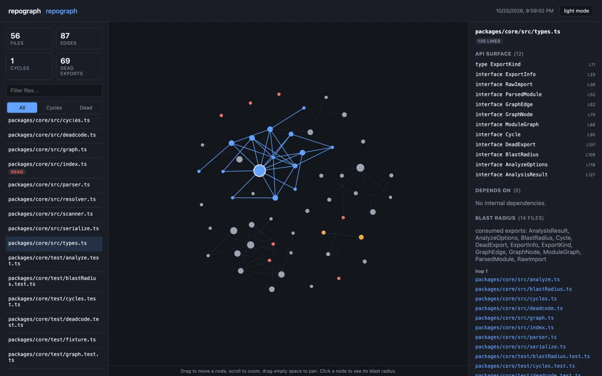
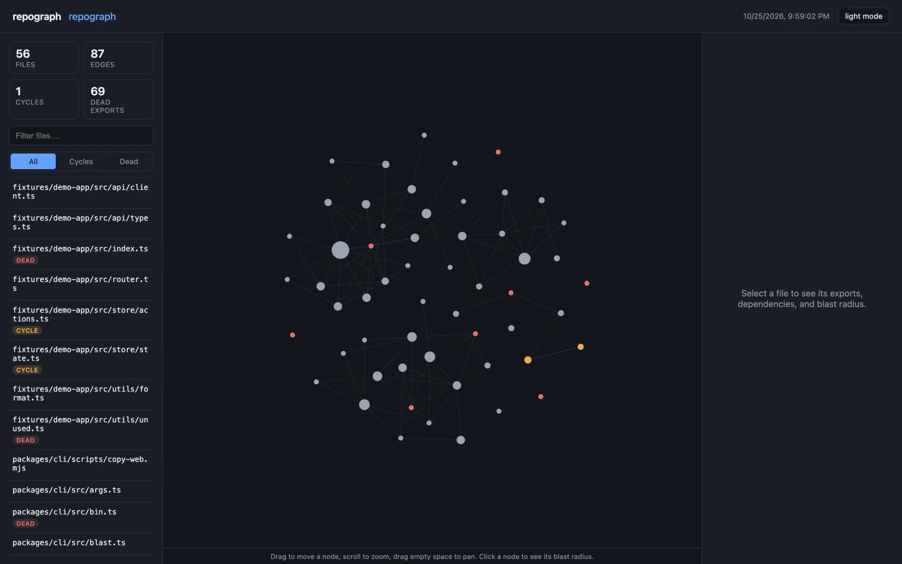

# repograph

repograph builds the module dependency graph of a TypeScript/JavaScript repository and
renders it as a clickable map. It reports import cycles, exports nobody imports, each
file's exported API, and the blast radius of a file: everything that transitively
imports it.

[Case study ↗](https://hellpuff.dev/work/repograph)



<sub>Real screenshot: `repograph html .` run on this repository at commit f389fbe. Selecting
`packages/core/src/types.ts` shows its API surface and a 14-file blast radius, highlighted on the graph.</sub>

```
repograph html ./my-project --out map.html
```

The result is one static HTML file. You can drag nodes, zoom, filter the file list, show
only cycles or only dead code, and click a file to see which files depend on it.

## How it differs from report-only tools

`madge --circular`, `depcheck` and `ts-prune` each run one of these checks and print
text. repograph runs all of them on the same graph and lets you inspect the result
visually. The specifics:

- **Blast radius.** Clicking a file highlights every transitive dependent, grouped by
  hop distance, and lists which of the file's exports those dependents actually reach
  (`consumedExports`). That separates an export forty files rely on from one that is
  merely exported.
- **Dead exports.** `export * from`, `import * as ns`, default vs. named imports and
  type-only imports are tracked separately, so re-exports and namespace imports don't
  produce false "unused" reports. Files passed with `--entry` are exempt, because an
  entry point's exports are its public API.
- **Cycles.** Cycles are the strongly connected components of size > 1, found with an
  iterative Tarjan's algorithm, so deep graphs don't overflow the call stack.
- **One file of output.** `repograph html` needs no server and no `node_modules` next
  to it. You can attach the file to a PR, open it from `file://`, or put it in a wiki.
- **Few dependencies.** `@repograph/core` depends only on `typescript`: it uses the
  compiler's parser and implements graph building, cycle detection, dead-export
  analysis and blast-radius BFS itself. The viewer's force-directed layout is also
  hand-written; its runtime dependencies are `react` and `react-dom`. The CLI depends
  only on `@repograph/core`.

## Status

Version 0.1.0, **not published to npm** (see below). CI runs build and tests on Ubuntu,
Windows and macOS with Node 20 and 22, plus lint, typecheck, coverage thresholds and a
dogfood job that diffs the CLI's output against the bundled fixture. The evidence behind
these claims, and what is not covered, is in
[docs/PRODUCTION_READINESS.md](docs/PRODUCTION_READINESS.md).

## Prerequisites

- Node.js >= 18 (`engines`); CI tests Node 20 and 22.
- npm (the repo is an npm workspace; `package-lock.json` is committed).
- A browser to open the generated HTML. No network access is needed at runtime.

## Install

This project is **not published to npm**. The `repograph` package on the npm registry
is an unrelated project by another author; do not `npm install --global repograph` or
`npx repograph` expecting this tool. Install from a clone:

```
git clone https://github.com/hellpuffyt/repograph
cd repograph
npm ci && npm run build
npm link -w packages/cli    # puts `repograph` on your PATH
```

(or run it directly: `node packages/cli/dist/bin.js html ./my-project --out map.html`)

## Usage

All commands take a directory to analyze. `.ts`, `.tsx`, `.js`, `.jsx`, `.mjs`, and
`.cjs` files are scanned; `node_modules`, `dist`, `build`, `.git`, and a handful of
other build-output directories are skipped by default.

### `repograph html <dir> [--out file.html] [--entry a.ts,b.ts]`

Writes a self-contained interactive HTML file: the graph, the analysis and the
viewer in one file that makes no external requests. This is the main way to use
repograph.

The embedded data carries repo-relative file paths and the analyzed directory's
basename only, not its absolute location on your disk.

```
$ repograph html fixtures/demo-app --entry src/index.ts --out map.html
Wrote interactive graph to map.html (8 files, 1 cycles, 7 dead exports).
```



<sub>Real screenshot: repograph's own module graph: 56 files, 87 edges, 1 cycle and 69 dead
exports at commit f389fbe, with cycle and dead-code nodes highlighted.</sub>

### `repograph serve <dir> [--port 4173] [--host 127.0.0.1] [--entry a.ts,b.ts]`

Same viewer, served over HTTP, and re-analyzed on every request, so editing the repo
and refreshing the browser shows the current graph without restarting anything.

```
$ repograph serve fixtures/demo-app --entry src/index.ts
repograph serving <absolute path to>/fixtures/demo-app at http://127.0.0.1:4173
Press Ctrl+C to stop.
```

The server binds `127.0.0.1` by default and answers only requests whose `Host` header
names the loopback interface (or the `--host` you bound), which blocks DNS-rebinding
reads from other websites. `--host 0.0.0.0` exposes your repo's file names and exports
to the network and prints a warning. A busy port is reported as an error.

### `repograph report <dir> [--entry a.ts,b.ts]`

A plain-text summary for terminals and CI logs. Exit code is `1` if any import cycle
was found, `0` otherwise, so it works as a CI gate.

This is real output, run against the small fixture app bundled in this repo
(`fixtures/demo-app`, also asserted byte-for-byte in CI; see
[`fixtures/demo-app.report.txt`](fixtures/demo-app.report.txt)):

```
$ repograph report fixtures/demo-app --entry src/index.ts
repograph report for demo-app
8 files, 7 internal dependency edges

Circular dependencies: 1
  - src/store/actions.ts -> src/store/state.ts -> src/store/actions.ts

Dead exports (never imported): 7
  - src/api/types.ts:6 ApiError (interface)
  - src/router.ts:3 Router (interface)
  - src/store/actions.ts:3 Action (interface)
  - src/store/state.ts:5 seed (function)
  - src/utils/format.ts:5 slugify (function)
  - src/utils/unused.ts:7 DEFAULT_LOCALE (const)
  - src/utils/unused.ts:3 legacyFormatter (function)

Most-depended-on files (top 6):
  - src/store/state.ts (imported by 2 files, imports 1)
  - src/api/client.ts (imported by 1 file, imports 2)
  - src/api/types.ts (imported by 1 file, imports 0)
  - src/router.ts (imported by 1 file, imports 1)
  - src/store/actions.ts (imported by 1 file, imports 1)
  - src/utils/format.ts (imported by 1 file, imports 0)
```

### `repograph blast <dir> <file> [--depth n]`

The blast radius of a single file: every file that transitively depends on it, grouped
by hop distance, and which of its exports those dependents consume.

```
$ repograph blast fixtures/demo-app src/store/state.ts
Blast radius for src/store/state.ts
  3 files affected across 2 hops
  Exports actually consumed: cache
  hop 1:
    - src/api/client.ts
    - src/store/actions.ts
  hop 2:
    - src/index.ts
```

### `repograph analyze <dir> [--entry a.ts,b.ts] [--out file.json]`

The raw analysis as JSON: every file's exports, its resolved internal/external
imports, every cycle and every dead export, for use in your own tooling (a CI
policy check, a custom report, etc.).

## What it detects

- **Module graph**: every internal `import`/`export ... from`/`require()`/dynamic
  `import()` resolved to a real file in the repo, plus a deduplicated list of external
  (npm) specifiers per file.
- **Circular dependencies**: strongly-connected components of size > 1, computed with
  Tarjan's algorithm.
- **Dead exports**: exports that no other file in the repo ever imports by name (or by
  default, for default exports). It errs toward fewer false positives:
  a file that's the target of any `import * as ns` or `export * from` has none of its
  exports flagged, since a namespace import can touch any of them.
- **API surface**: every exported function, class, interface, type, enum, and
  const/let/var per file, with its kind, source line, and a truncated signature.
- **Blast radius**: for any file, every transitive dependent grouped by hop distance,
  plus which of that file's own exports are the ones reached by that BFS.

## What it does not do

- **No type checking.** repograph parses syntax (imports/exports/declarations) with the
  TypeScript compiler API but never builds a full `ts.Program` or runs the type
  checker, so it works the same on `.js` files with no `tsconfig.json` and skips the
  cost of type checking. It won't catch a type error; that's `tsc`'s job.
- **No path-alias resolution.** Only relative (`./`, `../`) and repo-root (`/`)
  specifiers are resolved to files; `tsconfig.json` `paths` / webpack aliases are
  treated as external. A repo without aliases gets full graph coverage.
- **No monorepo cross-package resolution.** Each `repograph` invocation analyzes one
  directory tree; a workspace with several `packages/*` each importing each other via
  their package names sees those as external imports, not internal edges.

## How it's built

```
packages/
  core/   @repograph/core — the analysis engine (scanning, parsing, graph building,
          cycle/dead-code/blast-radius algorithms). Zero runtime dependencies besides
          the TypeScript compiler API itself.
  cli/    repograph — the command-line tool. Depends only on @repograph/core; ships
          the pre-built web viewer as a static asset.
  web/    @repograph/web — the interactive viewer (React + a hand-written canvas
          force-directed layout, no charting/graph library dependency). Built by Vite
          into one self-contained HTML file (vite-plugin-singlefile) that the CLI
          copies into itself and injects analysis data into.
fixtures/
  demo-app/  A small, deterministic example app (an import cycle, several dead
             exports, a couple of hub files) used by the test suite and CI's dogfood
             job, which asserts the CLI's exact output against it.
```

The parser is syntactic-only (no full `ts.Program`/type checker), so each file is
parsed once on its own, whether or not a `tsconfig.json` exists.
The graph builder resolves every import specifier against the actual set of scanned
files (trying the specifier as-is, with each supported extension appended, and as a
directory with an index file) before deciding whether an edge is internal or external.

## Development

```
npm ci
npm run build       # builds core, then the web viewer, then the CLI
npm test -w packages/core
npm test -w packages/cli   # needs the build: the CLI tests load the built viewer
npm run lint
npm run typecheck
npm run coverage -w packages/core   # fails below the thresholds in vitest.config.ts
npm run coverage -w packages/cli
```

`npm test` at the root runs only the core suite.

See [CONTRIBUTING.md](CONTRIBUTING.md) for more.

## Security

repograph reads source files under the directory you give it and never executes them.
Symlinked directories are not followed, and symlinked files are only included when they
resolve inside that directory, so a report cannot pick up files from elsewhere on disk.
Please report vulnerabilities privately as described in [SECURITY.md](SECURITY.md).

## License

MIT. See [LICENSE](LICENSE).
